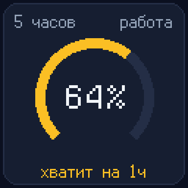
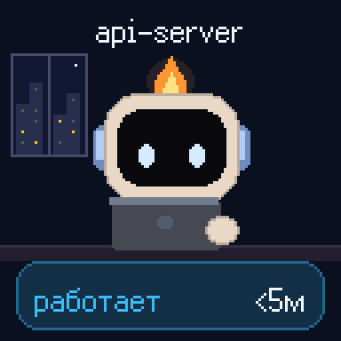
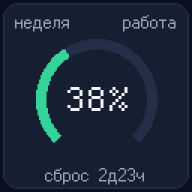
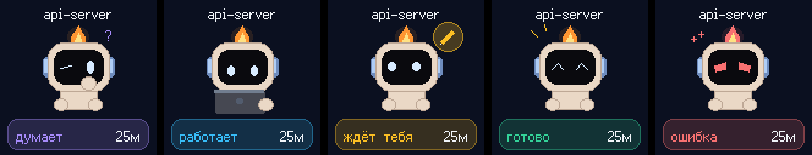
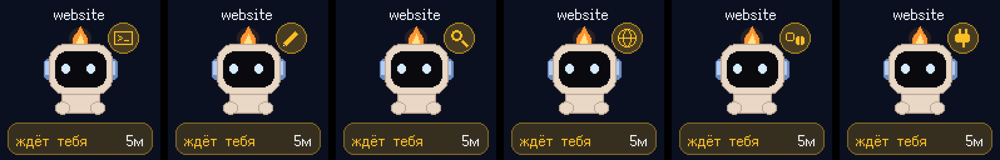
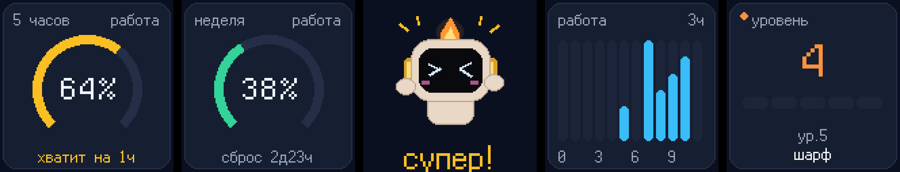

# Agent Gate

**Your Claude Code sessions, live on a Divoom Times Gate.**

Five 128×128 pixel screens on your desk. Each running Claude Code session gets a screen with its own little flame-topped robot that thinks, types on a laptop, waits for you, celebrates or panics. The robot in the middle is the dispatcher: it waves toward whichever session needs you. The screens that no session is using show your Claude usage limits, today's activity and the robot's level.

<p align="center">
  
</p>
<p align="center"><sub>Two sessions: <code>api-server</code> is working, <code>website</code> asks permission to run a terminal command. The dispatcher points at it. The 5-hour limit warns it will run out in about an hour.</sub></p>

Inspired by [Pixel Agents](https://github.com/pixel-agents-hq/pixel-agents) and [Claude Office](https://github.com/paulrobello/claude-office), but made for a physical gadget you can see from across the room.

> The on-screen labels are in Russian for now (the project started as a personal desk setup). Contributions with other languages are welcome.

## What you see

| Screen | Shows |
|---|---|
| Session (screens 2, 4, then 1, 5) | Project name, the robot in the pose of its status, and how long it has been in it |
| Dispatcher (screen 3) | Waves toward a session that asks permission (or just finished), watches the working ones, keeps a board of how many sessions wait, work, are done or failed, celebrates long jobs, falls asleep after 30 quiet minutes |
| 5-hour limit | Ring gauge, time to reset, and a forecast ("enough for 1h") when you burn it faster than it resets |
| Weekly limit | Ring gauge and days to reset |
| Activity | Claude's busy time per hour over the last 12 hours |
| Level | The robot levels up with every finished answer and unlocks blush, golden headphones, a scarf, a star badge and a glow |



Session statuses: thinking, working, waiting for you, done, error. When Claude asks for permission, a badge shows what for: terminal, file edit, search, web, sub-agent or an MCP tool.



With no sessions running, the free screens fill up with widgets, never repeating:



And the robot grows with you:


## How it works

```
Claude Code session ──hook──▶ data/state.json ◀── MCP server (Claude Desktop chat)
                                   │
                           daemon (launchd)
                         renders 5 screens, sends only the changed ones
                                   │  Device/PlayGif: "fetch this GIF from me"
                                   ▼
                     Divoom Times Gate ──HTTP GET──▶ tiny frame server on your Mac
```

- **Statuses come from Claude Code hooks**, not from the model. The hook fires on prompt, tool use, permission request, end of turn and session end, takes about 30 ms and never blocks Claude.
- **Limits come from Claude Code's own `/usage`**: free, no tokens, the same numbers as the usage page. Refreshed every 2 minutes while you work.
- **Accounts**: the Claude app tells every session which account it runs under. The gate shows the sessions and limits of the account you used last, so switching between work and personal accounts switches the gate too.
- **The device pulls lossless GIFs** from a small HTTP server on your Mac (pushing JPEGs knocks the Times Gate off Wi-Fi over time). Animations loop on the device itself, so the screens stay alive without network traffic.
- **Fewer redraws**: every new picture costs a loading animation on the Times Gate, so timers move in coarse steps and a screen must settle for 3 s before it is sent.
- The daemon survives the gate rebooting, Wi-Fi dropping and the router giving the gate a new IP (it finds it again by MAC).

## Setup

You need a Mac, a Divoom Times Gate on the same Wi-Fi, Claude Code, and the system Python 3 (`/usr/bin/python3`).

1. **Get the code** somewhere outside Desktop, Documents and Downloads (macOS blocks background apps there):
   ```bash
   git clone https://github.com/milalucky/agent-gate ~/agent-gate
   cd ~/agent-gate
   ./install.sh
   ```
   The first run creates `.env` and stops.
2. **Fill in `.env`.** In the Divoom app open the Times Gate, then *Device settings → Device info* for the IP and the LocalToken. Optionally add the MAC address (`arp -a | grep <ip>`), so the gate is found again if its IP changes.
3. **Run `./install.sh` again.** It installs Pillow if needed, adds the hooks to `~/.claude/settings.json` (your existing hooks stay) and starts the daemon at login with launchd.
4. Start any Claude Code session: it appears on the gate within a few seconds.

The Times Gate's local API works only after it has talked to the Divoom cloud once after boot, so give it a minute after power-on.

### A second Claude account

Usage limits are read through the `claude` command line tool, which is logged in to one account. To also see the limits of another account, log it in into its own config folder:

```bash
CLAUDE_CONFIG_DIR=~/.claude-personal claude auth login
```

and add the folder to `.env`:

```
CLAUDE_CONFIG_DIRS=~/.claude-personal
```

Until then the limit screens for that account say "нет данных / войди в claude".

### Claude Desktop chat (optional)

Chats in the Claude app have no hooks, so they report through an MCP server instead. Run `./install_mcp.sh`, then quit Claude with ⌘Q: the script waits for the app to close, registers the `times-gate` server and reopens it. Paste [CLAUDE_INSTRUCTIONS.md](CLAUDE_INSTRUCTIONS.md) into the app's personal instructions so Claude sets its status at the start and end of each answer.

## Everyday commands

```bash
python3 cli.py preview                    # writes preview.png of all five screens, no device needed
python3 cli.py session demo api working   # fake a session to try the look
python3 cli.py end demo
python3 cli.py show 4 "Ушла обедать" -d 600
python3 test_state.py                     # self-check
tail -f data/daemon.log
launchctl kickstart -k gui/$(id -u)/com.agentgate.daemon   # restart the daemon
```

## Troubleshooting

- **Screens show the Divoom clocks after a power cut.** The daemon notices within 15 s and resends everything once the gate is back online, which can take a minute or two.
- **"Times Gate не отвечает" in the log.** Check the IP in the Divoom app. With `DIVOOM_MAC` set the daemon finds the gate itself; reserving its IP in the router fixes it for good.
- **A loading hourglass before each update.** That is the Times Gate firmware fetching the picture. Agent Gate keeps updates rare; it cannot hide the hourglass itself.
- **Nothing appears for a session.** Make sure the hooks are in `~/.claude/settings.json` and the project folder is not in Desktop, Documents or Downloads.

## Files

| File | Role |
|---|---|
| `hook.py` | Claude Code hook: session statuses |
| `state.py` | Shared state, sessions, accounts, levels |
| `limits.py` | Claude usage limits via `/usage` |
| `render.py`, `robot.py`, `style.py` | The screens, the robot, palette and fonts |
| `device.py` | Times Gate transport: frame server + `Device/PlayGif` |
| `daemon.py` | Main loop, run by launchd |
| `mcp_server.py` | MCP server for Claude Desktop chats |
| `cli.py`, `test_state.py` | Manual control and self-check |

## Credits

- Fonts: [Ark Pixel](https://github.com/TakWolf/ark-pixel-font) and [Departure Mono](https://github.com/rektdeckard/departure-mono), both SIL Open Font License (see `fonts/`).
- Times Gate protocol notes from [divoom-times-gate](https://github.com/gokselozr/divoom-times-gate), [divoom-times-gate-controller](https://github.com/fbg-jap/divoom-times-gate-controller) and [hacs-divoom-times-gate-dev](https://github.com/averhaegen/hacs-divoom-times-gate-dev).
- Not affiliated with Anthropic or Divoom.

## License

MIT
